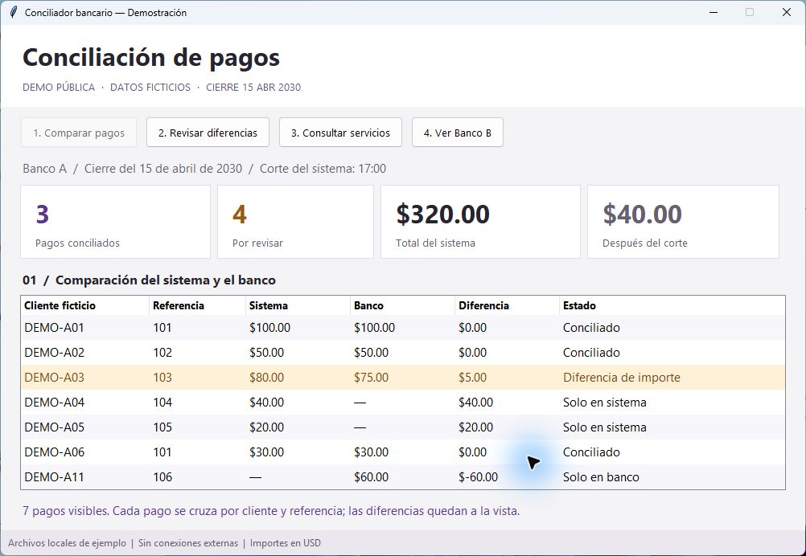

# Conciliador bancario

**La aplicación compara pagos y concentra la revisión en las diferencias.**

Proyecto de portafolio, enfocado en análisis de datos aplicado a recaudación, crédito y control financiero.



[Ver el recorrido animado de la demostración](evidencias/recorrido.gif)

> Demostración pública con datos 100 % ficticios, creados desde cero. No contiene reportes, clientes, credenciales, consultas ni conexiones de una empresa. No ejecuta anulaciones ni modifica pagos.

## El problema

Al cerrar las recaudaciones, necesitaba comparar lo registrado en el sistema con lo reportado por el banco. Un pago podía faltar, tener otro importe o quedar fuera del horario de cierre. Revisar todo fila por fila hacía más difícil concentrarme en lo que necesitaba atención.

Además, una referencia puede repetirse para clientes distintos. Cruzar solo por esa referencia puede multiplicar filas y dar una impresión equivocada del cuadre.

## El proceso

Organicé esa revisión en una aplicación que lee los reportes, ordena las referencias y compara cada pago usando **cliente + referencia**. El resultado separa cuatro situaciones:

- **Conciliado:** aparece en ambas fuentes con el mismo importe.
- **Diferencia de importe:** aparece en ambas, pero el valor cambia.
- **Solo en sistema:** requiere comprobar qué ocurrió; no implica una anulación automática.
- **Solo en banco:** requiere revisar por qué falta en el sistema.

También muestra cuánto se registró después del corte, conserva una copia de las fuentes y consulta un catálogo ficticio de servicios para aportar una pista sobre los pagos pendientes.

## Resultados reproducibles

La muestra representa un cierre ficticio del **15 de abril de 2030**, con apertura el día anterior.

| Resultado de la muestra | Banco A | Banco B |
|---|---:|---:|
| Pagos conciliados | 3 | 2 |
| Diferencias de importe | 1 | 1 |
| Solo en sistema | 2 | 1 |
| Solo en banco | 1 | 1 |
| Total del sistema dentro del corte | $320,00 | $310,00 |
| Total bancario considerado | $315,00 | $305,00 |
| Registrado después del corte | $40,00 | $20,00 |
| Coincidencias en servicios ficticios | 1 | 1 |

Los importes son USD de ejemplo. Estas cifras describen exclusivamente los CSV incluidos; no son resultados de una empresa ni estimaciones de ahorro.

Una coincidencia en servicios **permanece en la lista de revisión**. Encontrar un registro relacionado no basta para decidir qué hacer con un pago.

## Aporte y alcance de esta versión

El proyecto parte de la experiencia como Auxiliar de Operaciones y Conciliaciones Bancarias. Definí la necesidad, las reglas de cierre y los casos de revisión, y desarrollé el proceso original con Python durante una tutoría.

Las pruebas y la adaptación pública se realizaron con asistencia de IA. Esta versión es una demostración simplificada y reconstruida para el portafolio; no es una copia de la aplicación operativa.

El proceso original incluye también descargas automatizadas y consultas a una base de datos. Aquí las entradas son CSV ficticios y la comprobación SQL se ejecuta en memoria con SQLite. No se incluyen integraciones SFTP, navegación por portales, servidores, usuarios, claves ni esquemas internos. La elección de demo carga archivos locales, no simula una conexión real.

## Probarlo en tres pasos

La ejecución requiere Python 3.11 o posterior y uv. La interfaz de ventanas utiliza Tkinter; la prueba sin ventanas no lo necesita.

```powershell
uv sync
uv run python app.py --demo
uv run python tests/verificar_demo.py
```

El segundo comando procesa ambos bancos y guarda los resultados en `salidas/`. Si ya existe el cierre, el programa lo conserva y pide otro destino:

```powershell
uv run python app.py --demo --salida salidas/segunda-prueba
```

Para abrir la aplicación con ventanas:

```powershell
uv run python app.py
```

La interfaz permite elegir un banco, cargar los archivos ficticios y seleccionar una carpeta de salida. También admite otros CSV con el mismo formato. La demostración pública está preparada exclusivamente con información ficticia.

Para abrir la vista de escritorio que aparece en el GIF:

```powershell
uv run python vista_demo.py
```

La vista permite recorrer los pagos, las diferencias, la consulta local de servicios y el segundo banco. Calcula los resultados con los mismos CSV y funciones del proyecto. El parámetro `--idioma en` muestra la versión en inglés. El GIF reúne capturas de esta ventana en Windows; no muestra la aplicación operativa ni datos de trabajo.

## Archivos que entrega

```text
salidas/banco-a/2030-04-15/
├── Cuadre/
│   ├── conciliacion.csv
│   ├── por_revisar.csv
│   ├── coincidencias_servicios.csv
│   └── resumen.json
└── Reportes/
    └── copias de los tres CSV utilizados
```

`resumen.json` contiene los conteos y totales. Los CSV pueden abrirse en Excel. Las fuentes originales no se modifican y un cierre existente no se sobrescribe.

## Cómo está organizado

| Archivo o carpeta | Para qué sirve |
|---|---|
| `app.py` | Elección de archivos, ejecución y ventanas. |
| `vista_demo.py` | Recorrido visual de los datos ficticios en una ventana de escritorio. |
| `conciliacion.py` | Fechas, importes, claves y comparación. |
| `comprobacion.py` | Consulta SQL local de servicios ficticios. |
| `exportacion.py` | Resultados y copias de las fuentes. |
| `datos/` | Cuatro CSV creados desde cero. |
| `sql/` | Consulta sobre tablas ficticias. |
| `tests/` | Comprobaciones reproducibles de los casos principales. |
| `docs/` | Reglas del ejemplo y descripción de los datos. |
| `evidencias/` | Resultado de ejemplo generado por el programa. |

## Qué demuestra

- **Finanzas y conciliación:** distinguir pagos coincidentes, diferencias y partidas pendientes.
- **Crédito y recaudación:** investigar un pago sin asumir que una ausencia equivale a un error del cliente.
- **Datos y BI:** convertir archivos en información consistente y verificable, preparada para análisis posterior.

## Límites

La demo usa un formato común para los CSV y dos reglas de cierre ficticias. Rechaza claves duplicadas dentro de cada fuente para evitar cruces ambiguos. No resuelve pagos parciales, cruces uno a muchos, comisiones ni movimientos en varias monedas. Los casos pendientes requieren criterio humano.

Los horarios se interpretan como hora local, sin conversión de zona horaria. El Banco B de la muestra entrega un archivo que ya corresponde al cierre: quien seleccione otro archivo debe comprobar que sea el correcto.

No se han medido ahorros de tiempo, reducción porcentual de errores ni impacto económico para esta versión.
